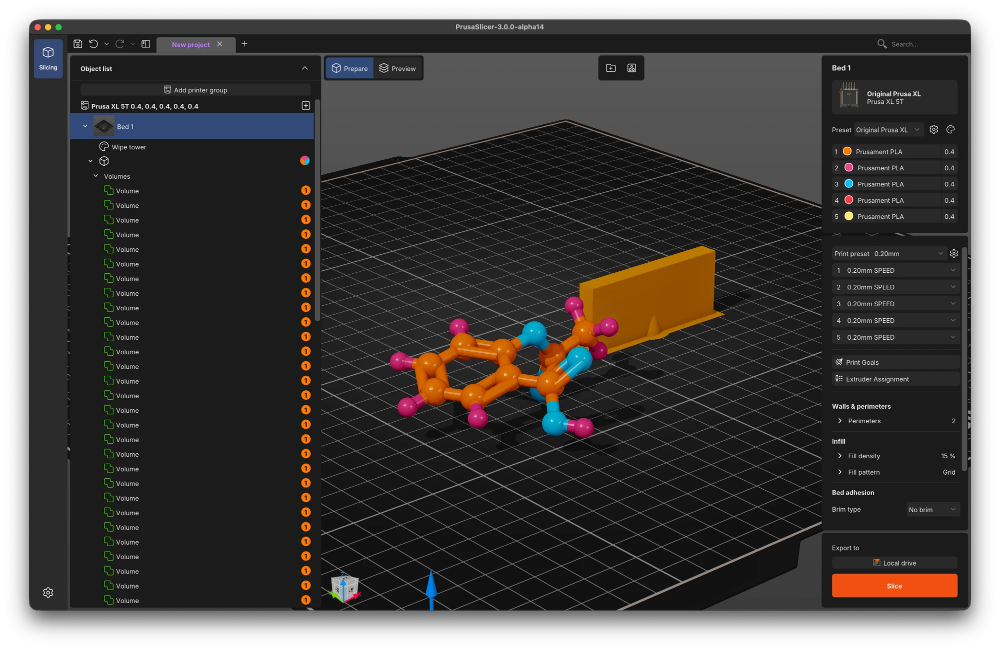
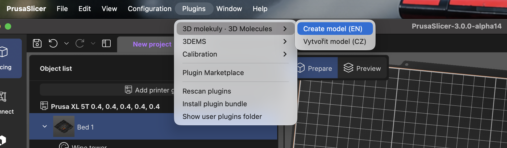
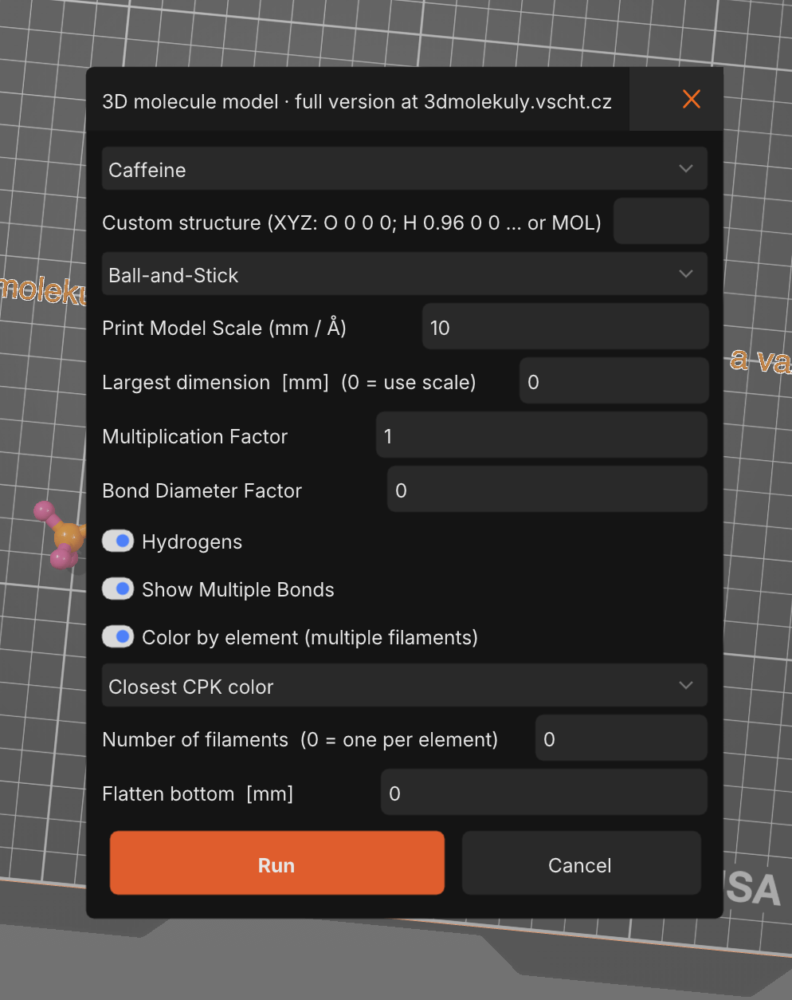
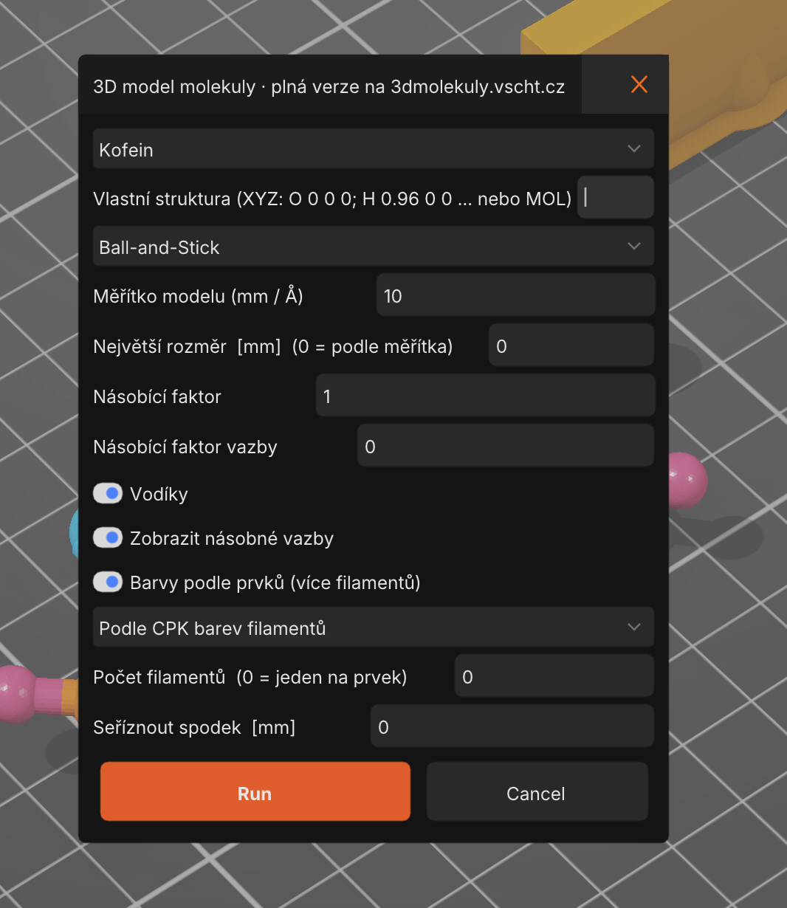
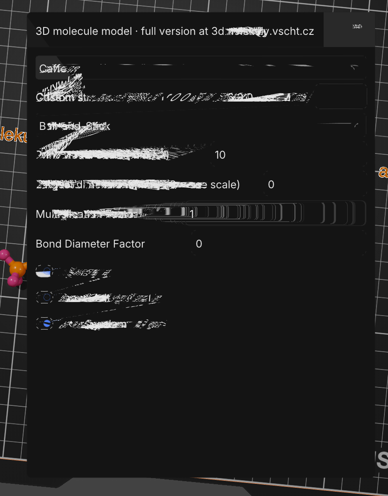

<div align="center">

# 3D Molecules for PrusaSlicer

**Multicolor, print-ready 3D models of molecules, built right inside PrusaSlicer.**

[](https://github.com/molekuly3d/3d-molekuly-prusaslicer-plugin/actions/workflows/check.yml)
[](LICENSE)
[](https://github.com/prusa3d/PrusaSlicer)
[](https://3dmolekuly.vscht.cz)



*Caffeine as a Ball-and-Stick model, each element on its own filament (Prusa XL 5T).*

</div>

A simplified, offline companion to the web app **[3dmolekuly.vscht.cz](https://3dmolekuly.vscht.cz)**.
Pick a molecule or paste your own structure, and the plugin places a model on the bed with every
element assigned to the filament closest to its CPK color.

> **Need more?** The full web app also searches PubChem, PDB and the Crystallography Open
> Database, imports PDB and CIF files, lets you draw a structure, and creates print-in-place
> moving joints and spheres split for gluing.

## Contents

- [Features](#features)
- [Requirements](#requirements)
- [Installation](#installation)
- [Quick start](#quick-start)
- [Settings](#settings)
- [Custom structures](#custom-structures)
- [Multicolor printing](#multicolor-printing)
- [Limitations](#limitations)
- [Known issues](#known-issues)
- [Development](#development)
- [References](#references)
- [License](#license)

## Features

- **15 ready-made molecules** with real 3D geometry from PubChem: water, methane, ammonia,
  carbon dioxide, ethene, ethyne, ethanol, acetic acid, sulfuric acid, cyclohexane, benzene,
  glucose, paracetamol, aspirin and caffeine.
- **Your own structures** in XYZ or MOL/SDF (V2000 and V3000).
- **Three model types:** Spheres (space-filling), Ball-and-Stick with double and triple bonds,
  and Sticks. Sizes and defaults match the web app.
- **Multicolor by CPK color:** elements are matched to the filaments you have loaded, so oxygen
  goes to red, nitrogen to blue and hydrogen to white.
- **Print-friendly options:** scale in mm per ångström or a target size in mm, adjustable atom
  and bond thickness, hydrogens on or off, flattened bottom for bed adhesion.
- **Czech and English** menu entries.

## Requirements

- PrusaSlicer **3.0.0-alpha13** or newer (the Lua plugin API is experimental and may change).
- For colors: a printer with several filaments, e.g. *CORE One + MMU3*, *CORE One INDX* or a
  multi-tool *Prusa XL*. On a single-filament printer the model is printed in one color.

## Installation

**From the Plugin Marketplace** (once published): in PrusaSlicer open the Plugin Marketplace,
search for *3D Molecules* and click *Install*.

**Manually:** copy the [`io.github.molekuly3d.molecules`](io.github.molekuly3d.molecules) folder to
the PrusaSlicer plugin folder and restart PrusaSlicer. PrusaSlicer opens the folder for you via
*Show user plugins folder*; on macOS it is `~/Library/Application Support/PrusaSlicer3/lua/`
(`PrusaSlicer3-dev` for development builds).

## Quick start

1. Set up your filaments first (the plugin reads their colors when it runs).
2. Open **Plugins → 3D molekuly · 3D Molecules → Create model (EN)** (or *Vytvořit model (CZ)*).

   

3. Pick a molecule, or paste your own structure.
4. Choose the model type and settings, then click **Run**. The model is placed on the current
   bed.

## Settings

Names, defaults and size formulas match the web app. Czech labels are in brackets.

<table>
  <tr>
    <td align="center"></td>
    <td align="center"></td>
  </tr>
  <tr>
    <td align="center"><em>Create model (EN)</em></td>
    <td align="center"><em>Vytvořit model (CZ)</em></td>
  </tr>
</table>

PrusaSlicer 3.0 alpha may show *Bond Diameter Factor* as 0 (a decimal default arriving as 0);
the plugin then uses the web app's default 0.4.

| Setting | Default | Meaning |
|---|---|---|
| Molecule *(Molekula)* | Caffeine | Built-in library of 15 molecules. |
| Custom structure *(Vlastní struktura)* | empty | When filled in, it overrides the selected molecule. |
| Select Model Type *(Typ zobrazení)* | Ball-and-Stick | `Spheres` (space-filling), `Ball-and-Stick`, `Sticks`. |
| Print Model Scale (mm / Å) *(Měřítko modelu)* | 10 | How many millimetres one ångström takes. |
| Largest dimension [mm] *(Největší rozměr)* | 0 | When above 0, the model is scaled so that its longest side has this length; the scale is then ignored. |
| Multiplication Factor *(Násobící faktor)* | 1 | Atom size (stick thickness for `Sticks`). |
| Bond Diameter Factor *(Násobící faktor vazby)* | 0.4 | Bond thickness for `Ball-and-Stick` (diameter = factor × scale). |
| Hydrogens *(Vodíky)* | on | Off removes H atoms and their bonds. |
| Show Multiple Bonds *(Zobrazit násobné vazby)* | on | Double and triple bonds as 2 or 3 parallel sticks. |
| Color by element *(Barvy podle prvků)* | on | Every element gets its own filament. |
| Filament assignment *(Přiřazení filamentů)* | Closest CPK color | How elements are matched to filaments, see [Multicolor printing](#multicolor-printing). |
| Number of filaments *(Počet filamentů)* | 0 | 0 = one filament per element. Otherwise elements beyond this number share the last filament. |
| Flatten bottom [mm] *(Seříznout spodek)* | 0 | Cuts off the bottom of the model for better bed adhesion. |

## Custom structures

The field is a single line, so lines are separated with a semicolon `;` (`|` or `\n` work too).

**XYZ** — one atom per line as `element x y z` (coordinates in Å). A leading atom count and a
comment line are skipped. Bonds are inferred from atom distances (covalent radii), all single:

```
O 0 0 0; H 0.96 0 0; H -0.24 0.93 0
```

**MOL / SDF (V2000 and V3000)** — the file contents, e.g. a *3D SDF* downloaded from PubChem
(*Download → 3D Conformer → SDF*). Bonds and bond orders are kept. From a file with several
molecules only the first one is used. Files with 2D coordinates (all z = 0) give a flat model;
only the web app computes a 3D shape from a 2D drawing.

The plugin handles up to 1000 atoms. When a structure cannot be read, the plugin places a text
with the error message on the bed instead of the model, because PrusaSlicer does not show plugin
errors otherwise. Delete the text afterwards.

## Multicolor printing

With *Color by element* on, every element gets its own filament. *Filament assignment* offers:

- **Closest CPK color** (default) — the plugin reads the filament colors of the printer and
  finds the assignment with the smallest total color difference to the CPK colors of the web app
  (C gray, H white, O red, N blue, S yellow…). Typical elements get "their" color; an element
  without a suitable filament (e.g. C without a gray one) gets what is left; extra elements share
  the closest color.
- **In order (C, H, O, N…)** — C, H, O, N, S, P, Cl, F, Br, I, then the rest alphabetically.
  Also used when the filament colors cannot be read.

Each half of a bond takes the color of the atom it belongs to, as in the web app.

**Colors only show up with multiple filaments.** The plugin always assigns filament numbers, but
a single-filament printer renders the whole model in the color of its only filament. To get a
multicolor model, switch the printer in the bed panel to a multi-filament variant (e.g.
*CORE One + MMU3*) and set the filaments; the model is colored automatically.

The plugin cannot add filaments or set their colors: the PrusaSlicer 3.0 plugin API only writes
numeric settings, and the list of filaments comes from the printer.

## Limitations

The plugin runs in PrusaSlicer's sandbox without network or file access. Therefore:

- **No PubChem or PDB search.** Download the structure elsewhere and paste it in.
- **No moving joints or spheres split for gluing.** These are web-only.
- **Volumes are not named after atoms** and cannot be merged into one part per element; the
  plugin API does not allow it yet. Volumes of one element are kept together in the object list,
  in filament order.

## Known issues

PrusaSlicer 3.0 is an alpha. Issues we know about:

- **A long text in *Custom structure* breaks the dialog rendering.** After pasting a large file
  (e.g. an SDF with hundreds of molecules) the dialog turns into a tangle of white lines. The
  model is still created, but paste one molecule only: for an SDF, the text from the name down
  to the `M  END` line.

  

- **Dialog labels must be single-line**; a multi-line label breaks the rendering the same way.
- **Restart PrusaSlicer after updating the plugin.** After *Rescan plugins*, a renamed menu entry
  can stay in the native macOS menu and crash PrusaSlicer when clicked.
- **Plugin errors are only logged** (`<PrusaSlicer3 folder>/shared_runtime/log.txt`), so the
  plugin prints them on the bed.

Found another one? Please [open an issue](https://github.com/molekuly3d/3d-molekuly-prusaslicer-plugin/issues).

## Development

```
3d-molekuly-prusaslicer-plugin/
├── io.github.molekuly3d.molecules/       the plugin bundle: everything in it ships
│   ├── manifest.json
│   ├── molecule_cs.lua, molecule_en.lua  menu entries: dialog labels per language
│   ├── generator.lua                  model assembly and error messages (PrusaSlicer API)
│   ├── chem.lua                       parsing, bond inference, geometry, CPK colors (pure Lua)
│   └── library.lua                    built-in molecules, generated from PubChem 3D SDF
├── tests/                             run.sh, tests against a mocked PrusaSlicer API
├── tools/                             sdf2lua.py + PubChem 3D SDF for the built-in library
├── docs/                              PLUGIN_API_NOTES.md, README images
├── .github/workflows/
│   ├── check.yml                      tests + dry-run signed bundle on every push
│   └── release.yml                    signs and publishes on a GitHub release
└── CHANGELOG.md, PUBLISHING.md, LICENSE
```

Run the tests (needs `lua5.4` and/or `luajit`):

```bash
tests/run.sh
```

Regenerate the built-in library after changing `tools/pubchem/` or the names in
`tools/sdf2lua.py` (keep the menu lists in `molecule_cs.lua` and `molecule_en.lua` in sync):

```bash
python3 tools/sdf2lua.py tools/pubchem io.github.molekuly3d.molecules/library.lua
```

`chem.lua` has no PrusaSlicer dependencies, so the geometry can be tested with a plain Lua
interpreter. Changes are listed in [CHANGELOG.md](CHANGELOG.md).

## References

- [PUBLISHING.md](PUBLISHING.md): step-by-step marketplace setup (author profile, signing key,
  trusted publishing, `release` environment), releasing a new version and troubleshooting.
- [docs/PLUGIN_API_NOTES.md](docs/PLUGIN_API_NOTES.md): what we learned about the PrusaSlicer 3.0
  plugin API while building this plugin (loading, dialog, meshes, config access, sandbox).
- [`ProjectApi.cpp`](https://github.com/prusa3d/PrusaSlicer/blob/master/src/slic3r-shared/src/Slic3r/App/Lua/ProjectApi.cpp)
  and [`doc/Plugin_API.md`](https://github.com/prusa3d/PrusaSlicer/blob/master/doc/Plugin_API.md)
  in the PrusaSlicer repository: the plugin API source and official guide.
- [prusa3d/plugin-marketplace-example](https://github.com/prusa3d/plugin-marketplace-example)
  and [prusa3d/plugin-marketplace-publish](https://github.com/prusa3d/plugin-marketplace-publish):
  Prusa's example repository and the GitHub Action used by our workflows.
- [Prusa Plugin Marketplace](https://plugin-marketplace.prusa3d.com): catalogue and author
  console.

## License

Released under the [GNU General Public License v3.0](LICENSE), the same license as the
[3D Molecules web app](https://github.com/molekuly3d/3D-Print-Molecules). Molecule geometries
in the built-in library come from [PubChem](https://pubchem.ncbi.nlm.nih.gov/).

Made by the 3D Molecules team at UCT Prague and the First Faculty of Medicine, Charles
University.
